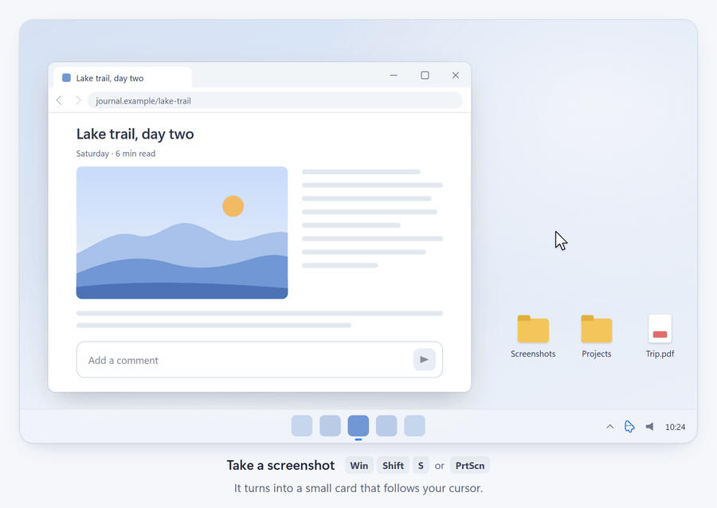

#  Igorio

Take a screenshot and it follows your cursor. Double-click to paste or save it, shake to let go. Sticky notes and screen recording are one key away. For Windows 10 and 11.



**[Download for Windows](https://github.com/Areshkew/igorio/releases/latest/download/Igorio-Setup.exe)** · [igorio.areshk.dev](https://igorio.areshk.dev)

## Use

- **Win+Shift+S** or **PrtScn**: take a screenshot. It becomes a small card on your cursor.
- **Double-click** a text box to paste it, or a folder or the desktop to save it as PNG.
- **Shake** the cursor to drop the top card. Keep shaking to drop them all.
- **Hold Alt** anywhere except a text box to open the tool menu: New note or Record screen.
- Notes are sticky notes with Markdown. Hide one with its hide button. **Notes…** in the tray lists them all.
- **Ctrl+Shift+6** records the screen under the cursor to MP4. Press it again to stop, and the video is carried like a screenshot.
- While recording: **Alt + scroll** zooms, **Ctrl+Shift+7** is the pen, **Ctrl+Shift+8** the highlighter.

Igorio lives in the notification area. **Guide…** in the tray shows the first-run guide again.

## Admin windows

Installed builds also work over windows that run as administrator. During setup, Igorio is signed on your machine so that Windows allows this.

The installer itself is not signed, so SmartScreen may warn you when you download or run it. Click **More info**, then **Run anyway**.

## Build from source

You need Rust stable on Windows.

```
cargo build -p igorio-app --release
```

To build the installer, install [Inno Setup 6](https://jrsoftware.org/isinfo.php) and run `installer\build.ps1`.

## Support

- GitHub Sponsors: the Sponsor button on this repo, or [github.com/sponsors/Areshkew](https://github.com/sponsors/Areshkew).
- [Pay what you want for Igorio on Polar](https://buy.polar.sh/polar_cl_fD77eebHRUazKLnDC7GmUVxaOvp0thmQb2wg04NjlfL).

## License

MIT, see [LICENSE](LICENSE).
